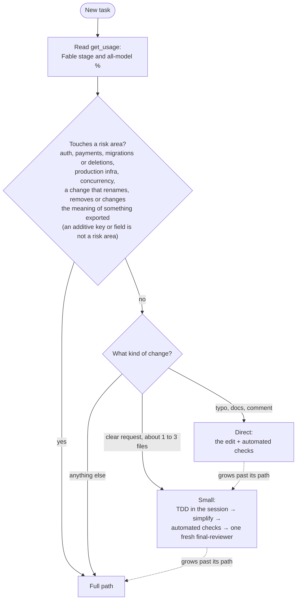
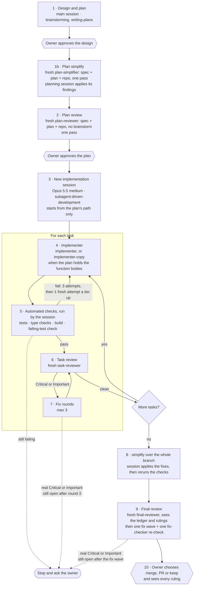
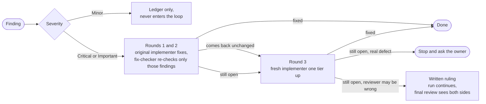
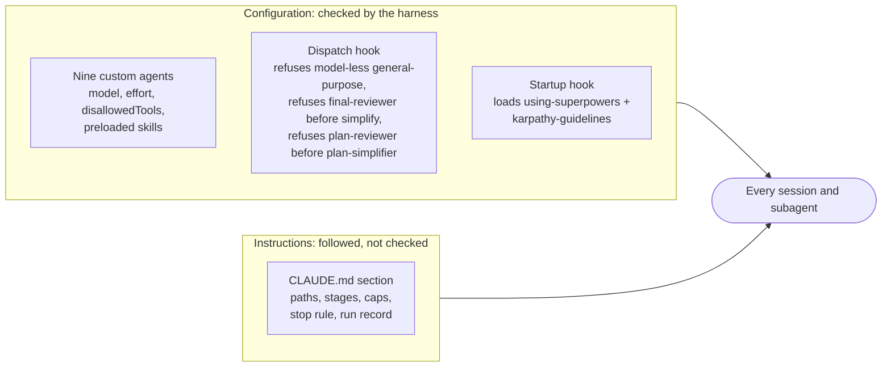

# claude-workflow

An agentic workflow for Claude Code. It sets how a task is routed, which model does each role, how work is reviewed and when a run stops for the owner, meaning you. This repo holds the parts that enforce it: hooks, custom agents, a `CLAUDE.md` section and three scripts. It also has an installer that puts them into `~/.claude`.

It's a template. Read it, change the models, thresholds and wording to fit your setup, then install it one step at a time.

> **Not yet confirmed live.** The parts are built and tested, but a few behaviours can only be checked on a real installation. See [Not yet confirmed live](#not-yet-confirmed-live).

## Goals

- **Reliable, clean, coherent code** comes first. Tokens matter only when usage limits would change which model does the work.
- **A known path for every task,** named at the start so the owner can correct it.
- **Fable where it best protects the code,** decided by a fixed rule, not by the point in the week.
- **Each role on a chosen model and effort,** pinned by configuration wherever configuration can do it.
- **No real defect carried forward silently.**
- **Upstream skills stay unedited,** so they can still be updated. `CLAUDE.md` outranks skills, so it redirects them instead.

## The workflow

### Choosing a path



The first message of every task names the path and why, the Fable stage, and the recommended model. If a task grows past its path, Claude stops, says so, and steps up.

### The Full path



The dispatch hook refuses a final review until `simplify` has run since the previous launched final review, so step 8 can't be skipped. A `general-purpose` final review is matched by its description.

A plan can mark consecutive tasks `**Wave:** A`, at most 3 to a wave, when they change no same part of a file, use nothing a sibling adds and have tests independent of their siblings; `plan-reviewer` checks each wave. The session then runs the wave's tasks at the same time: `scripts/wave.py start` gives each task its own worktree and branch from the wave's base, and every per-task step, from the implementer to the task review and its fix rounds, runs as before in that worktree. When all are complete, `wave.py merge` merges the task branches in plan order, the session folds the implementers' `Conventions:` lines into `## Code conventions`, and `wave.py finish` removes the worktrees. One `task-reviewer` then checks the wave's whole diff for what the single-task reviews couldn't see, such as duplicate helpers or diverging patterns, as the wave check, and its findings get a task's fix rounds.

### Fix rounds



Tiers go `implementer-copy` → `implementer` → `implementer-escalated`. In Fable stage 3 an Opus implementer stays on a fresh `implementer`. Loops run only on mechanical signals, such as failing tests, and always under a cap: a reviewer can always find something.

### Test-driven development and the failing-test check

TDD is the default on the Small and Full paths. After each task the session runs `scripts/failing-test-check.py` on the task's new or changed test files, in temporary copies, so the working tree isn't touched:

1. **Control:** the tests run on the task's final code and must pass. If they don't, the result is `couldnt_run`, reported without blocking, so a broken environment never looks like a failing test.
2. **Check:** the same test files run on the code from before the task and must fail. If they pass, the tests don't cover the change, and the result is `failed`, which goes back to the implementer.

This doesn't prove the test was written first. It proves the new tests can catch the change. A task with no new behaviour (refactor, docs, config) is marked `**Failing-test check:** exempt: <reason>` in the plan.

```bash
/usr/bin/python3 -I ~/.claude/scripts/failing-test-check.py --base <task start SHA> [--repo DIR] [--test-file PATH]... [--link node_modules]... [--timeout SECONDS] -- <test command>
```

Results: `passed` exits 0, `failed` and `no_tests` exit 1, `couldnt_run` exits 3.

### Preventing over-engineering

- **The five rules,** for plans, code and fixes, outranking the skills' templates: **Simplest first** (the smallest direct change), **Reuse before writing** (use or extend what exists, never a parallel version), **Match the codebase** (its style and abstractions, no new structure), **No pattern yet** (take the simplest way and suggest any alternative to the owner) and **Decisions live in the project's `CLAUDE.md`** (one line each under `## Code conventions`).
- **Before writing:** on the Full path, `plan-simplifier` checks the plan for excess before plan review: reuse, what doesn't trace to the spec, altitude and test proportion. The planning session cuts what the spec doesn't require, and the owner sees each cut, each declined finding and any spec flags at plan approval.
- **While writing:** `karpathy-guidelines` is in every main session through the startup hook, and in implementers and reviewers through agent frontmatter.
- **After writing:** `simplify` runs once per final review, and on the Small path.
- **At review:** `final-reviewer` also lists what the spec doesn't require. That list goes to the owner, never into fix rounds.
- **The finding bar:** outside risk areas, a "this can break" finding is Critical or Important only with a shown path in this code; inside one, plausibility is enough, and a shown path makes it at least Important, even if it looks rare or benign, judged per finding. A finding naming the existing helper or pattern a change duplicates or departs from is Important, and so is a missing or contradicted `## Code conventions` entry. `fix-checker` reports a fix that closes its finding with a parallel function, a test-only parameter or more change than needed as "fixed, not proportionate", which counts as still open.

## Models and effort

| Role | Agent | Model | Effort |
|---|---|---|---|
| Design and plan | main session | Fable | `high`, `xhigh` for the hardest architecture |
| Plan simplify | `plan-simplifier` | Opus 5.5 | `high` |
| Plan review | `plan-reviewer` | Fable | `high` |
| Session running implementation | main session | Opus 5.5 | `medium` |
| Implementer | `implementer` | Opus 5.5 | `high` |
| Implementer when the plan holds the code | `implementer-copy` | Sonnet 5.5 | `medium` |
| Round 3 from Opus | `implementer-escalated` | Fable | `high` |
| Task review | `task-reviewer` | Opus 5.5 | `high` |
| Re-check of listed findings | `fix-checker` | Sonnet 5.5 | `medium` |
| Sweeps | `sweeper` | Haiku | `medium` |
| Final review, and the Small path's reviewer | `final-reviewer` | Opus 5.5; Fable in risk areas | `high`; `xhigh` in risk areas |
| The four agents `simplify` launches | `general-purpose`, model passed at dispatch | Opus 5.5 | `high` |

### Fable stages

At task start Claude reads `get_usage`, works out the share of the week gone (`100 * (168 - hours_to_reset) / 168`) and compares the weekly Fable % with it.

| Stage | Trigger | Other main sessions | Design and plan | Plan review | Final review |
|---|---|---|---|---|---|
| 1 | Up to 15 points ahead of the week | Owner's choice, Fable allowed | Fable | Fable | Opus 5.5; Fable at `xhigh` in risk areas |
| 2 | More than 15 points ahead | Opus 5.5 with Fable advisor | Fable | Fable | Opus 5.5; Fable at `xhigh` in risk areas |
| 3 | 90% used or more | Opus 5.5, advisor off | Opus 5.5 | Opus 5.5 | Opus 5.5; Fable at `xhigh` in risk areas |
| Out | Fable unavailable | Opus 5.5 | Opus 5.5 | Opus 5.5 | Opus 5.5 at `xhigh` |

The all-model limit is watched too: Claude warns when it is more than 15 points ahead of the week, and at 90% no new Full path run starts without the owner's OK. Nothing silently drops to Sonnet. A stage 3 or Out override is an explicit `model` at dispatch on the named agent, and so is `final-reviewer` in a risk area: `model: fable` with `effort: xhigh`. `plan-simplifier` isn't in the table: it is pinned to Opus 5.5 at `high` in every stage.

### The Fable advisor (trial)

The advisor is on in stages 1 and 2 and off from stage 3. Only the owner can switch it (`/advisor fable`, `/advisor off`), so Claude reminds them when the stage changes.

| Role | Consults the advisor |
|---|---|
| Implementers | Only when stuck on a recurring failure, or before departing from the plan |
| Session running implementation, other Opus main sessions | At their own judgment |
| Reviewers, `fix-checker`, sessions already on Fable | Never |

After each consultation the model writes `Advisor: <what it advised> | changed: yes or no | <what changed>`. The advice itself is encrypted, so this note is the only view of its content. The trial reaches a checkpoint after 5 Full path runs or 3 weeks; it stops early if the advisor takes more than 25% of a week's Fable use.

## How it's enforced



| Piece | File | What it does |
|---|---|---|
| Custom agents | `agents/*.md` | Nine agents with model and effort pinned in frontmatter. Implementers can't spawn agents; reviewers can't edit files and never consult the advisor. `sweeper`, on Haiku, is read-only the same way: it takes a lookup of five or more reads off the main session and reports only the conclusion, under 300 words, each fact with where it was read and what it couldn't verify marked, with no count line. Reviewers give each finding a category from their area's list and end with a guarded `Strengths:` section. Task and final reviewers end with a fixed `Findings: critical=N important=N minor=N [unneeded=N] strengths=N` line, `fix-checker` with `Verdicts: fixed=N not_proportionate=N open=N`, `plan-simplifier` with `Findings: cuts=N flags=N strengths=N` and `plan-reviewer` with `Findings: findings=N strengths=N`. |
| Dispatch hook | `hooks/guard-agent-dispatch.py` | PreToolUse on `Agent`. Denies a dispatch with no `model` when the type is missing or `general-purpose`, which would otherwise run silently on the main session's model. Denies a final review, `final-reviewer` or a `general-purpose` one matched by description, until the transcript shows `simplify` since the previous launched final review. Denies a plan review, `plan-reviewer` or a `general-purpose` one matched by description, until the transcript shows a launched plan simplify since the previous launched plan review. Silent on everything else, never answers `allow`, fails open. |
| Startup hook | `hooks/session-start-superpowers.sh` | On `startup`, `clear` and `compact`, prints `using-superpowers` and `karpathy-guidelines`. A missing file is noted on stderr; the rest still loads. Combined output stays under the 10,000-character cap. |
| Commit guard | `hooks/guard-main-commit.py` | Optional. Answers `ask` for a commit landing on `main` or `master`, `deny` in bypass mode. |
| `CLAUDE.md` section | `claude-md/agentic-workflow.md` | The rules above in 28 lines, installed between `<!-- agentic-workflow:start -->` and `<!-- agentic-workflow:end -->`. |
| Failing-test check | `scripts/failing-test-check.py` | See above. |
| Wave script | `scripts/wave.py` | `start` makes a worktree per task from the wave's base and keeps the linked folders out of git, `merge` merges the task branches in plan order and stops at the first conflict, `finish` removes the worktrees and branches once all are merged and clean, refusing otherwise. |
| Health check | `scripts/workflow-report.py --health` | Report-only. Checks each recorded run against transcripts and git rather than the run record: `simplify` before each final review, named agents, the dispatch hook, the startup guidelines, `Findings:` lines, conventions added, `fix_growth`, sessions that wrote no run record and, for schema 2 records, each step, count line, finding total, agent pin and required skill, a risk area on the Small path and a wave with no wave check, and for schema 3 plan records a required offer with no entry, and for schema 4 records each step's agent id against the launched dispatches (missing, unknown, mismatched or shared ids), and for schema 5 records each finding's category and validity, each review step's strengths, and their number against its report's count line. Per main session this week, it also flags a launched plan review with no launched plan simplify since the previous one, and a typed trigger whose skill never loaded. Each problem becomes a `WARN` line in `--brief`. It also prints two information lines over this week's main transcripts, like the session checks: inline sweeps, and transcripts over the cap without a handoff. The runs `--health` and `--brief` list default to the last 7 days. |
| Report | `scripts/workflow-report.py` | Read-only. Reads transcripts and the run log; reports advisor calls, tokens and estimated cost by role, missing advisor notes, findings and fix rounds per run, and failing-test check results. `--json` prints the same data as one JSON object; `--html` writes it as one self-contained page. |

Still unenforced, by design: choosing the path, reading the stage, the main session's model, the fix-round cap, and whether the guidelines are followed once loaded. Naming the path and stage out loud is what lets the owner catch a wrong call.

## Tracking outcomes

- **Run record:** when a Small or Full path run finishes, the session appends one JSON line to `~/.claude/workflow-log.jsonl`. `workflow-report.py --schema` prints the format. Schema 2 records add `schema`, `started`, `plan`, `archive` and `steps`: each step that ran, with its agent, model, effort, count line and findings, each finding with its outcome (`fixed`, `applied`, `declined`, `deferred`, `ruled`, `open` or `to_owner`). Schema 3 records add `offers`: each skill offered during the run, with its outcome. Schema 4 records add `agent_id` to each dispatched step: the id the Agent tool returned, which names the step's subagent transcript, so the reporter ties step, dispatch and transcript without guessing. Schema 5 records add `categories`, the version of the category list, and to each finding its `category`, the reviewer's, from its step's area list, and its `validity` (`valid`, `invalid` or `unclear`), the session's call; each review step adds its `strengths`. A planning session appends a `path: "plan"` record right after the owner approves the plan. Older records stay as written and are still read.
- **Ledger and archive:** every run keeps a ledger from its first message, with a `Started:` line and one numbered line per finding (`F1`, `F2`…), updated by number when its outcome or validity changes, and one per strength (`S1`, `S2`…); the record is filled from it. A Full run uses the SDD ledger and copies it to `~/.claude/workflow-archive/<date>-<branch>.md` before the workspace is deleted. A Small run keeps its ledger there from the start, and a planning session in `<date>-<branch>-plan.md`. `/` in the branch is replaced, a suffix is added when the name is taken, and the session creates the folder with `mkdir -p` on first use. The archive is local and private, and `--health` notes a recorded archive that is missing or has another `Started:` time.
- **Weekly view:** `workflow-report.py --brief` prints at most three lines, including any `STOP` or `CHECKPOINT` the owner should see, and any `WARN` from the health check.
- **Health check:** `workflow-report.py --health` runs the same checks on demand and at the trial checkpoint. It and `--brief` read the last 7 days unless `--since` is given; `--json` and `--html` read everything.
- **JSON:** `workflow-report.py --json` prints every run in range, its steps and findings, and the totals as one JSON object with a `version`. Each WARN also comes as an object with its kind, its run or session, and its step, skill or agent; each run and session carries its transcript's title; each session also carries its start, end, project (its first working directory) and the slash commands typed in it, by name and time, never their arguments; the stage table comes once under `stage_table`; each finding carries its category and validity, each review step its strengths, and the list itself comes under `categories`; each step carries its agent id, time and end, each dispatch its id, time, end and the step it is tied to, and a skill load the step it is. Each run and session also carries `phases`, its spend split by phase (design, plan writing, implementation, each review step, simplify, coordination, unattributed), per model with its cost per token kind and its advisor calls, which add up to its `models` and `advisor`. Each run and session also carries `context`, its main-transcript calls and their context tokens, median and max, whether it passed the 300K cap, the calls past it and its handoff time; `tool_results`, the characters of tool results by class; and `sweeps`, its inline and delegated sweeps; `totals.context` sums them per week. A handed-off run reads its whole chain of transcripts, back through each `Handoff` session start, as one window. Every transcript row belongs to one run or to its transcript's session, so every total is a sum over the runs and sessions exported. It holds personal data: print it, never write it into a repo.
- **Cache:** the reporter keeps what it parsed from each transcript in `~/.claude/workflow-report-cache/`, by the file's size and time, so only new or grown transcripts are read again; `--no-cache` bypasses it and gives the same output. The folder is local and private. `--json --changed-since CURSOR` prints only the runs and sessions whose entry changed since the export that gave the cursor, each under a stable `key`, with the keys removed since and a new `cursor`; `--changed-since 0` starts from nothing.
- **Page:** `workflow-report.py --html [FILE]` writes the same data as one self-contained HTML page, by default `~/.claude/workflow-dashboard.html`, outside every repo. It opens from disk and stays private. `/workflow-dashboard` rebuilds it and publishes it as a private artifact, updating the same link each time; running the command is the owner's yes, and nothing else publishes it.

```bash
/usr/bin/python3 -I scripts/workflow-report.py --brief
```

```bash
/usr/bin/python3 -I scripts/workflow-report.py --since 2026-11-01
```

```bash
/usr/bin/python3 -I scripts/workflow-report.py --json --since 2026-11-01
```

```bash
/usr/bin/python3 -I scripts/workflow-report.py --html
```

### Offered skills and commands

A skill or command the owner triggers is offered at a fixed moment, or never. The session asks one yes/skip question and runs it only on yes; a skip means "not now", and the offer comes back at its next moment.

| Skill or command | When it's offered |
|---|---|
| `grill-me` | On every Full design, once, right before the owner approves it. |
| `handoff` | At the cap, at a stopping point, drafted so a yes costs only the switch. |
| `workflow-dashboard` | Never offered: the owner runs `/workflow-dashboard` when they want the page, and its link stays the same, so nothing is lost by waiting. |

## Layout

```
agents/          nine custom agents
claude-md/       the CLAUDE.md section
hooks/           dispatch hook, startup hook, commit guard
scripts/         failing-test check, workflow report, wave.py
skills/          workflow-dashboard: the /workflow-dashboard command
tools/           replay_dispatches.py: replays past dispatches through the dispatch hook
tests/           unittest suites, run as subprocesses against temp folders
install.py       the installer
```

## Requirements

- macOS or Linux, with Python 3.9 or later at `/usr/bin/python3`. Everything is standard library, run as `/usr/bin/python3 -I`.
- Claude Code, with access to the models named in `agents/*.md`. The `CLAUDE.md` section reads usage with `mcp__ccd_session_mgmt__get_usage` and starts sessions with `start_session`, which are tools of the Claude desktop app's Code tab; elsewhere, adapt those lines. If yours differ, edit the `model:` and `effort:` lines there, the role table in `tests/test_workflow_files.py`, and the stage table in `claude-md/agentic-workflow.md`.
- The [superpowers](https://github.com/obra/superpowers) skills. The startup hook reads `~/.claude/skills/using-superpowers/SKILL.md`; a plugin install puts the skill elsewhere, so link it there or change the path in `hooks/session-start-superpowers.sh`.
- The `karpathy-guidelines` skill, from the [andrej-karpathy-skills](https://github.com/forrestchang/andrej-karpathy-skills) plugin marketplace, added as `karpathy-skills` so it sits at `~/.claude/plugins/marketplaces/karpathy-skills/`. If yours lives elsewhere, change the path in the same hook.
- Weekly usage windows: `scripts/workflow-report.py` counts weeks from Sunday 07:00 UTC (`week_start`). Set it to your own weekly reset.
- The `simplify` and `code-review` skills that ship with Claude Code.

## Installing

Clone the repo and run the suite first (see [Tests](#tests)):

```bash
git clone https://github.com/<your-github-user>/claude-workflow.git
```

```bash
cd claude-workflow
```

The installer works one step at a time, so you can check each step before the next. Every write goes through a temp file and a rename. Invalid input stops with exit 2 before anything is written.

Hooks and agents load into running sessions within seconds, so install when no important run is in progress. A new `agents` folder needs a session restart to load.

```bash
/usr/bin/python3 -I install.py snapshot
```

```bash
/usr/bin/python3 -I install.py agents
```

```bash
/usr/bin/python3 -I install.py section
```

```bash
/usr/bin/python3 -I install.py scripts
```

```bash
/usr/bin/python3 -I install.py skills
```

```bash
/usr/bin/python3 -I install.py hooks
```

The `hooks` step copies all three hooks, but it only adds the dispatch hook to `~/.claude/settings.json`. To use the startup hook and the commit guard, copy their entries from `tests/settings-snippet.json` into `~/.claude/settings.json` yourself.

Before you rely on the dispatch hook, replay past dispatches to see what it would have refused:

```bash
/usr/bin/python3 -I tools/replay_dispatches.py
```

## Rolling back

`snapshot` copies `settings.json`, `CLAUDE.md` and `hooks/` into `~/.agents/backups/<YYYY-MM-DD-HHMM>-workflow/` and prints the path. To undo everything, pass that path back:

```bash
/usr/bin/python3 -I install.py rollback ~/.agents/backups/<snapshot folder>
```

Rollback restores what the snapshot holds. It removes every file the installer copies that the snapshot doesn't hold. Other files stay.

## Tests

```bash
for t in tests/test_*.py; do /usr/bin/python3 -I "$t" || break; done
```

The tests run the real scripts as subprocesses against temp folders whose paths contain spaces. They may read the real `~/.claude` but never write to it. One test runs the startup hook against your real `~/.claude` to check its output stays under Claude Code's 10,000-character cap. It fails if `using-superpowers` or `karpathy-guidelines` isn't installed where the hook looks, and it's skipped on CI. GitHub Actions runs the same loop on macOS on every push and pull request.

## Not yet confirmed live

These can only be confirmed on a real installation:

- Whether agent frontmatter honours `effort`. A plugin skill name in `skills:` does load: the skill's text is in the agent's context.
- What `transcript_path` the dispatch hook sees for a dispatch from a nested session.
- The shape of a real advisor row in a transcript, which `workflow-report.py` reads.
- Whether advisor calls count against the weekly Fable limit.
- Whether an implementer whose working directory is a task worktree can write its report into the session's workspace, a sibling path. If not, the report goes in the task worktree's own workspace and the session reads it there.
- Whether an implementer follows its dispatch's "every command starts in the task worktree" when each of its Bash calls starts in the session's working directory; `git -C` and the SDD scripts' `-C` are the fallback.
- Whether git's locking handles `wave.py start` and a concurrent `failing-test-check.py` adding worktrees to the same `.git`.
- What the wave check finds over the first few runs: if nothing, it can go; if a lot, the rule on shared files is too loose.

## Credits

This workflow builds on other people's work. It points to their skills and doesn't copy them:

- [superpowers](https://github.com/obra/superpowers) by Jesse Vincent (obra): brainstorming, writing-plans, subagent-driven-development, test-driven-development and the using-superpowers rules this workflow redirects.
- [`karpathy-guidelines`](https://github.com/forrestchang/andrej-karpathy-skills) by forrestchang: guidelines against over-engineering, based on Andrej Karpathy's observations on LLM coding pitfalls.
- `simplify`: the Claude Code skill that reviews changed code for reuse and simplification.

## Licence

MIT. See [LICENSE](LICENSE).
